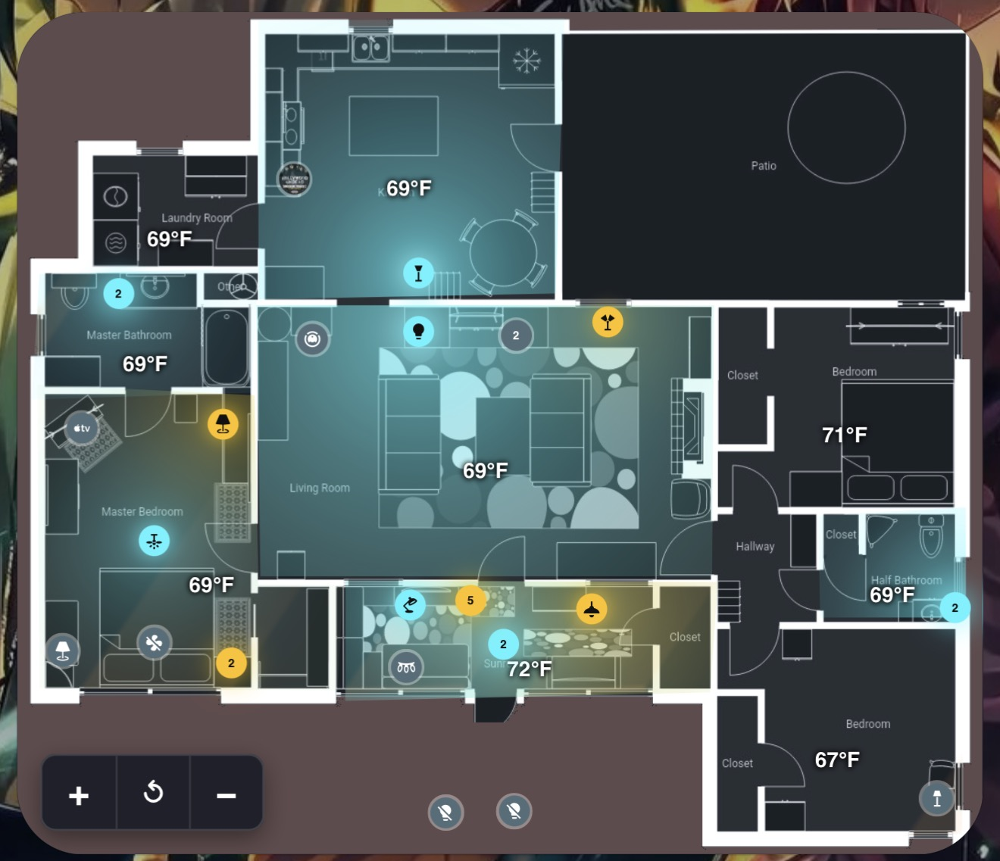

# Visual Floorplan Card

A custom Home Assistant Lovelace card that turns a floor plan image into an interactive, living map of your home. Drop devices on the map, trace rooms and bind them to Home Assistant Areas, and watch your house glow with the real colors of your lights, the time of day, and the sun and moon shining through your windows.

**No YAML required.** The built-in visual editor writes the config for you.

Card type: `custom:visual-floorplan-card`



---

## Features

### Map and navigation
- Floor plan image as the background
- Mobile-friendly pan and zoom (1x to 6x)
  - Pinch to zoom, drag to pan, mouse wheel on desktop
  - On-screen **+ / reset / -** buttons
  - Double-tap empty space to reset the view
- Zoom buttons can be placed in any corner, vertical or horizontal

### Devices
- Drop any entity on the map, drag it to move it, and resize each one individually
- **Lights** show their real color and dim with their brightness
- **Media players, people, and cameras** can show their artwork or photo instead of an icon
- **Sensors** display their value (with units) right on the map
- **Glow effect** per device, with adjustable intensity (0x to 3x) or fully off
- **TV glow**: media players can cast an ambient backlight glow into their room while playing
- **Custom tap and hold actions** per device: toggle, more-info, call a service, navigate to a dashboard page, open a URL, or do nothing
- **Smart stacking**: devices placed at nearly the same spot collapse into one numbered bubble. Tap it to fan them out, tap again to close
- Unavailable or missing entities are dimmed so you can spot them

### Light groups
- Define a light group (for example a group entity for your living room) with member lights
- Members inherit the group's tap and hold actions, so tapping any light in the group controls the whole group
- Members can be added or removed in the editor

### Rooms
- Trace a room by tapping its corners, then bind it to a Home Assistant **Area**
- Drag the corners later to fine-tune the shape
- **Hold a room** to toggle every light in that Area (a plain tap does nothing, so you will not trigger it by accident while panning)
- Rooms glow in the blended color and brightness of the lights inside them
- **Green outline** when motion, occupancy, or presence sensors in that Area are on
- Shows the **Area temperature** if it has a temperature sensor
- **Has Walls & Roof** toggle: indoor rooms clip their light inside the walls, while open areas like patios and decks can spill light freely

### Outdoors, sun, and moon
- The area outside your floor plan changes color with the **sun's elevation** and the **moon's phase**, including sunrise and sunset warmth
- Pick an Area for **outdoor lights** and they glow on the ground outside the house
- **Hold anywhere outside the house** (on the transparent part of your image) to toggle all outdoor lights
- **Sunlight and moonlight through windows**: mark your windows on the map and light streaks into the room based on the real sun and moon position
  - Set which way north points on your map with the compass
  - Adjust how far the light reaches into rooms

### Built-in visual editor
- Pick a room, pick a device, tap the image to place it
- Trace rooms, mark windows, set the compass, and manage light groups
- Per-device settings for size, glow, intensity, artwork, TV glow, and actions
- Tap and hold actions are set from dropdowns, with a JSON box for extra service data

---

## Installation

### HACS (custom repository)
1. In Home Assistant, open **HACS**
2. Open the three-dot menu and choose **Custom repositories**
3. Add `https://github.com/YOUR-USERNAME/visual-floorplan-card` and choose **Dashboard** (older versions of HACS call it **Lovelace**) as the category
4. Search for **Visual Floorplan Card**, install it, and reload your browser

### Manual
1. Download `visual-floorplan-card.js`
2. Copy it to `/config/www/` on your Home Assistant system
3. Go to **Settings > Dashboards**, open the three-dot menu, and choose **Resources**
4. Add a resource:
   - URL: `/local/visual-floorplan-card.js`
   - Type: **JavaScript Module**
5. Hard refresh your browser

---

## Setup

### 1. Get a floor plan image
Any image works, but for the best results:
- Use a **dark** floor plan, because the glow effects show up best against dark backgrounds
- Use a **PNG with a transparent background** outside the walls if you want the outdoor sky color, outdoor lights, and hold-outside-to-toggle features to work
- Put it in `/config/www/` (for example `/config/www/floorplan.png`), which Home Assistant serves as `/local/floorplan.png`

### 2. Assign Areas in Home Assistant
Rooms are bound to Home Assistant **Areas**, so make sure your lights, sensors, and devices are assigned to the right Areas under **Settings > Areas**.

### 3. Add the card
1. Edit a dashboard and click **Add card**
2. Search for **Visual Floorplan**
3. Enter your image path (for example `/local/floorplan.png`)
4. Use the tabs to build it out:
   - **Place**: choose a room and device, then tap the image to drop it
   - **Entities**: customize size, glow, artwork, TV glow, and tap/hold actions
   - **Rooms**: pick an Area, trace the room, and finish it
   - **Windows**: tap both ends of each window on the wall

---

## Configuration

The editor generates all of this for you, but you can also edit it in YAML.

### Card options

| Option | Type | Default | Description |
|---|---|---|---|
| `image` | string | `/local/floorplan-house-dark.png` | Path to your floor plan image |
| `elements` | list | `[]` | Devices placed on the map |
| `zones` | list | `[]` | Traced rooms bound to Areas |
| `windows` | list | | Windows used for sun and moon light |
| `light_groups` | list | | Light groups and their actions |
| `outside` | object | | Outdoor area, sun, and moon settings |
| `icon_size` | number | `32` | Default device size in pixels |
| `off_color` | hex string | `#546e7a` | Color for devices that are off |
| `stack_radius` | number | `2.5` | Devices closer than this (% of image) stack into a bubble. `0` turns stacking off |
| `zoom_layout` | `vertical` / `horizontal` | `vertical` | Zoom button layout |
| `zoom_corner` | `bottom-right` / `bottom-left` / `top-right` / `top-left` | `bottom-right` | Zoom button position |
| `north` | number (degrees) | `0` | Which way north points on your map |
| `sun_reach` | number | `1` | Multiplier for how far sunlight reaches into rooms |

### Element options (`elements`)

| Option | Type | Default | Description |
|---|---|---|---|
| `entity` | string | required | Entity ID |
| `x`, `y` | number | required | Position as a percentage of the image |
| `size` | number | `icon_size` | Size in pixels |
| `glow` | boolean | `true` | Cast a glow when active |
| `glow_intensity` | number | `1` | Glow strength multiplier (0 to 3) |
| `tv_glow` | boolean | `false` | Media players only: cast an ambient TV backlight while playing |
| `picture` | boolean | `true` | Show artwork or photo for media players, people, and cameras |
| `tap_action` | object | toggle or more-info | Action on tap |
| `hold_action` | object | more-info | Action on hold or right-click |

### Zone options (`zones`)

| Option | Type | Default | Description |
|---|---|---|---|
| `area` | string | required | Home Assistant Area ID |
| `name` | string | | Display name |
| `points` | list of `[x, y]` | required | Corners of the room (percent of image) |
| `has_walls` | boolean | `true` | Clip indoor light to the room. Turn off for open areas like patios |

### Window options (`windows`)

| Option | Type | Description |
|---|---|---|
| `x1`, `y1`, `x2`, `y2` | number | Both ends of the window (percent of image). Must be next to a traced room |

### Outside options (`outside`)

| Option | Type | Description |
|---|---|---|
| `area` | string | Area whose lights count as outdoor lights |
| `sun` | string | Sun entity (usually `sun.sun`) |
| `moon` | string | Moon entity (a moon phase sensor) |

### Light group options (`light_groups`)

| Option | Type | Description |
|---|---|---|
| `entity` | string | The group entity |
| `members` | list | Light entities controlled by this group |
| `tap_action` | object | Action when any member is tapped |
| `hold_action` | object | Action when any member is held |

### Actions

Used by `tap_action` and `hold_action`:

| Action | Extra options |
|---|---|
| `toggle` | `entity` (optional) |
| `more-info` | `entity` (optional) |
| `call-service` | `service`, `entity`, `data`, `no_entity` |
| `navigate` | `path` |
| `url` | `url` |
| `none` | |

### Example

```yaml
type: custom:visual-floorplan-card
image: /local/floorplan.png
icon_size: 32
north: 0
outside:
  area: backyard
  sun: sun.sun
  moon: sensor.moon
light_groups:
  - entity: light.living_room_group
    members:
      - light.lamp_left
      - light.lamp_right
elements:
  - entity: light.lamp_left
    x: 32
    y: 40
  - entity: light.lamp_right
    x: 36
    y: 40
  - entity: media_player.living_room_tv
    x: 50
    y: 30
    tv_glow: true
    glow_intensity: 1.5
  - entity: lock.front_door
    x: 12
    y: 60
    tap_action:
      action: call-service
      service: lock.unlock
zones:
  - area: living_room
    name: Living Room
    has_walls: true
    points:
      - [25, 25]
      - [60, 25]
      - [60, 55]
      - [25, 55]
windows:
  - x1: 25
    y1: 30
    x2: 25
    y2: 45
```

---

## Tips

- **Stacked bubbles in the editor**: tapping a stack in the Place tab with a device selected adds the new device to that exact spot
- **Room not glowing?** Make sure the lights are assigned to the same Area as the room, and that you placed them on the map
- **Sun streaks not showing?** Windows must be drawn right next to a traced room, the sun entity must be set under Outside, and you need to set the compass so north matches your map
- **Outdoor features not working?** Your image needs transparent pixels outside the house
- **Moonlight through windows** uses your Home Assistant location (latitude and longitude) to calculate where the moon is

---

## Contributing

Bug reports, ideas, and pull requests are welcome. Open an issue and include your card config (with anything private removed) and a screenshot if it helps.
